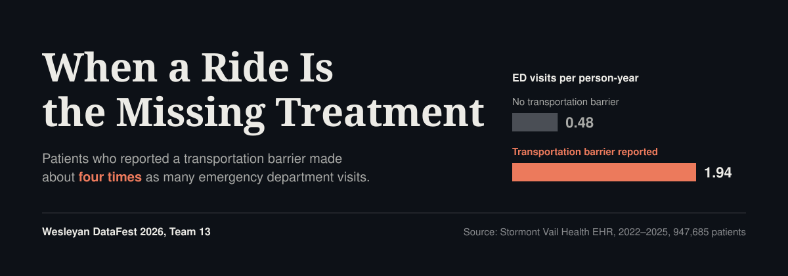
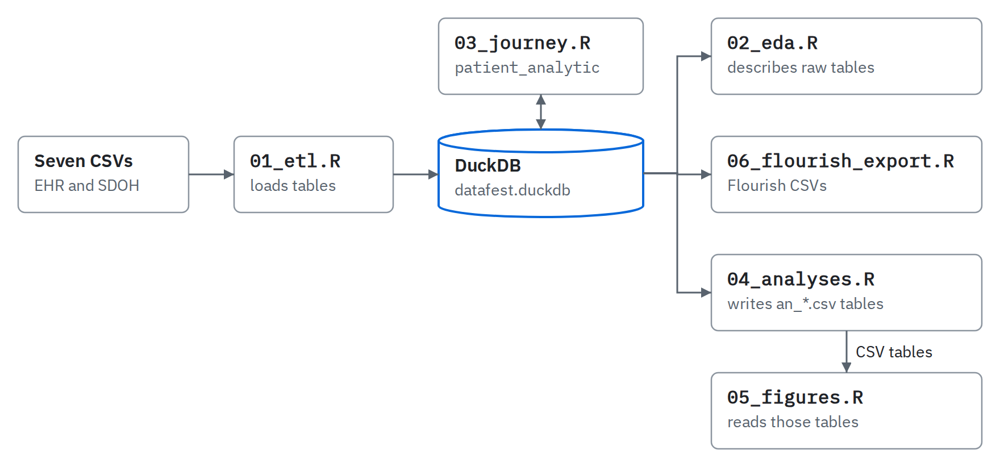

<picture>
  <source media="(prefers-color-scheme: dark)"  srcset="assets/banner-dark.svg"  type="image/svg+xml">
  <source media="(prefers-color-scheme: light)" srcset="assets/banner-light.svg" type="image/svg+xml">
  <source media="(prefers-color-scheme: dark)"  srcset="assets/banner-dark.png">
  <source media="(prefers-color-scheme: light)" srcset="assets/banner-light.png">
  
</picture>

[](https://github.com/Builder106/datafest-2026/actions/workflows/ci.yml)
[](https://www.r-project.org/)
[](https://duckdb.org/)
[](#license)
[](https://datafest-2026.vercel.app/)
[](https://ww2.amstat.org/education/datafest/)

> A single question, *"Has lack of transportation kept you from medical appointments?"*, identifies a patient group with **over 3x higher odds** of an emergency department visit after adjusting for age and sex. This repository contains the reproducible analysis pipeline behind that finding.

When patients can't get a ride to routine appointments, problems that a clinic visit could handle may end up in the emergency department instead. This project used de-identified records covering 7.6 million encounters for 947,685 patients to compare acute-care use between patients who did and didn't report a transportation barrier.

Patients who reported a barrier made about four times as many emergency department visits per person-year and about three times as many inpatient admissions. The data is observational, so it shows who is at risk, not what an intervention would save. Since the health system already asks the question, the answer is a ready way to flag patients for ride support, tele-visits, or case management.

**Live site:** [datafest-2026.vercel.app](https://datafest-2026.vercel.app/)

## What this is

Team 13's project for **[ASA DataFest 2026](https://ww2.amstat.org/education/datafest/)** at **Wesleyan University** (April 17 to 19, 2026). The data sponsor was **Stormont Vail Health**, which provided an anonymized electronic health record sample linked to social needs survey responses.

Full deliverables:

- **[Team13_Writeup.pdf](Team13_Writeup.pdf)**: 1-page summary writeup
- **[Team13_Presentation.pdf](Team13_Presentation.pdf)**: 4-slide presentation deck
- **[analysis/](analysis/)**: Complete R and DuckDB data processing scripts

## Key findings

| Outcome | No barrier reported (n = 55,653) | Transport barrier reported (n = 2,986) | Comparison |
| --- | --- | --- | --- |
| ED visits per person-year | 0.48 | **1.94** | 4.0x the rate |
| Inpatient admissions per person-year | 0.22 | **0.70** | 3.2x the rate |
| Any ED visit in the window | 43% | **68%** | adjusted OR **3.17** (95% CI 2.93 to 3.43) |
| Any inpatient admission in the window | 35% | **63%** | adjusted OR **3.49** (95% CI 3.23 to 3.77) |

The odds ratios come from a logistic model, `outcome ~ transport + age + sex`, fit on the 58,639 screened patients. They compare odds, not visit counts, so they aren't interchangeable with the rate ratios above them.

*What this means:*
- **ED visits**: Patients who reported a transportation barrier made about four times as many emergency department visits per person-year.
- **Inpatient admissions**: The same patients had about three times as many inpatient admissions per person-year, and higher odds of any admission after adjusting for age and sex.
- **Across chronic conditions**: Among patients with an index encounter for hypertension, type 2 diabetes, chronic kidney disease, or atrial fibrillation, barrier patients returned to the ED within 180 days more often in every cohort (33% vs 15%, 40% vs 17%, 37% vs 21%, and 34% vs 24%). Barrier patients were also younger (median age 51 vs 61), so the gap isn't explained by age.

For the full caveats, see the [writeup](Team13_Writeup.pdf) and the [Caveats](#caveats) section below.

## Pipeline

After the ETL, everything reads from one DuckDB file. The exception is `05_figures.R`, which reads the CSV tables that `04_analyses.R` writes.

<picture>
  <source media="(prefers-color-scheme: dark)" srcset="assets/diagrams/pipeline-dark.png">
  
</picture>

[Edit the diagram](assets/diagrams/pipeline.html).

`07_slide4_line_export.R` runs separately and draws the slide 4 chart from the Flourish CSVs. Outputs land in `output/tables/`, `output/figures/`, and `output/flourish/`.

**[run_all.R](analysis/R/run_all.R)** runs the pipeline. After a run, **[smoke_test_outputs.R](analysis/tests/smoke_test_outputs.R)** checks that the expected outputs exist.

## Reproducing the analysis

The raw EHR data is **not** in this repo (license restriction). The pipeline is reproducible against any DataFest 2026 CSV bundle dropped into `DataFest 2026 - Data Challenge/Data/2026-ASA-DataFest-Data-Files/`.

```bash

# 1. R packages (one-time, into ~/R/datafest_libs)

Rscript -e 'install.packages(c("data.table","duckdb","DBI","dplyr","tidyr","stringr","lubridate","ggplot2","scales"), lib="~/R/datafest_libs")'

# 2. Drop the CSV bundle into place

# DataFest 2026 - Data Challenge/Data/2026-ASA-DataFest-Data-Files/*.csv

# 3. Run the pipeline (builds ~/.datafest_cache/datafest.duckdb on first run)

Rscript analysis/R/run_all.R

# 4. Smoke-test the outputs

Rscript analysis/tests/smoke_test_outputs.R
```

If the DB already exists, skip ETL: `Rscript analysis/R/run_all.R --skip-etl`.

The shared SQL for Flourish CSV exports lives in **[analysis/sql/](analysis/sql/)** and can be run by the DuckDB CLI directly (see **[analysis/sh/flourish_export_duckdb_cli.sh](analysis/sh/flourish_export_duckdb_cli.sh)**).

Full run-order details: **[analysis/README.md](analysis/README.md)**.

## Caveats

The data is observational and the screening sample is non-random.

- Only **~6%** of patients in the release (61,052 / 947,685) answered the transportation questions, so absolute prevalences shouldn't be projected to the whole system.
- **20%** of encounter rows carry a diagnosis key that isn't in the diagnosis lookup (a known data issue per the sponsor Q&A), so the chronic-disease cohorts are a lower bound.
- **65%** of patients have no parseable location code, so geographic models were not fit.
- Patient journeys are tracked within the 2022 to 2025 window; rates are annualized by observed follow-up.

## Tech stack

- **R 4.3+** for data processing and statistical analysis
- **DuckDB** for fast queries across 7.6 million hospital encounter records
- **Flourish & RAWGraphs** for interactive charts
- **ffmpeg** for video exports
- **LaTeX (XeLaTeX)** for the research writeup PDF

## Acknowledgments

- **Stormont Vail Health** for the de-identified healthcare dataset
- **[Wesleyan QAC](https://www.wesleyan.edu/qac/)** for hosting Wesleyan DataFest 2026
- **[American Statistical Association](https://www.amstat.org/)** for the DataFest program

## License

Code in this repository is released under the [MIT License](LICENSE). The underlying EHR and survey data are **not** included and remain subject to the data-use agreement with Stormont Vail Health and the ASA DataFest 2026 release terms.
